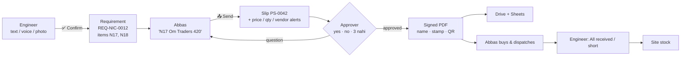

# Purchase Approval Bot (WhatsApp)

A WhatsApp bot that runs site purchases for a multi-site construction company and makes leakage visible:

1. **Site requirements** (Nicobar, Kamorta, Diglipur) keep coming into the *Kailash Material* group as text, **voice notes in Hindi**, or **photos of handwritten lists**. Abbas forwards each one to the bot, or engineers message the bot directly. The bot turns it into a clean, numbered requirement for the right site.
2. **Logistics (Abbas)** sees every open item, sorted by site, and writes a purchase note the way he already does: *"N17 N18 Om Traders 420, K4 Hira Metals 62/kg"*. The bot builds a **purchase slip** and checks every line against past purchases.
3. **The approver** gets the slip on WhatsApp as a PDF plus a short summary with alerts. He replies **"haan"**, **"no"**, or **"3 nahi"**, or taps a button. Only then does the bot issue the final slip with **his name, initials stamp, timestamp, verification code and QR code**, signed with a key only the server holds.
4. The signed slip goes to logistics and observers. It is filed in **Google Drive**, and every line is logged in a **Google Sheet** (Purchase Register, Requisitions, Stock Ledger, Stock Summary, Audit Log).
5. When Abbas forwards his dispatch post (photo of the list + "handed over to Prem in ship" / "loaded in Anand Bus"), the bot reads every item and asks the site to confirm what arrived with one tap. Shortages go straight to Abbas and Dad. **Site stock** updates from what actually arrived.



See [`docs/samples/`](docs/samples) for real output from the scripted demo: a pending slip, a signed partly-approved slip, the requirement list, and the full WhatsApp conversation.

## What stops leakage

| Leak | Control in the bot |
|---|---|
| Buying things no site asked for | Lines without a site requirement are flagged **"Not requested by any site engineer"** |
| Buying more than asked | **"Buying 60 bag; site asked for 50"** |
| Inflated rates | Every line is compared with the last approved rate for the same item: **"Rate ₹420 is 6.3% above last ₹395 (Om Traders, 10 Oct)"** |
| New or friendly vendors | Vendors not on the approved list are flagged **"New vendor"** |
| Buying the same thing twice | **"Already bought 40 bag for Nicobar on 10 Oct (PS-0001)"** |
| Requirements invented at the office | Requirements Abbas types on a site's behalf are marked and flagged |
| Edited or forged slips | Ed25519 signature over the exact approved contents. The QR code opens a page that shows **INVALID** if anything was changed |
| Material that never reaches site | The engineer confirms receipt. Shortages are sent to logistics **and the approver** at once |
| "He said yes on the phone" | Only the approver's WhatsApp number can approve. Every reply is stored with its message ID in the audit log |
| Approving an outdated version | Each slip has a version. Approving an old message after Abbas changed the slip does nothing |

**Approvals are never decided by AI.** Claude only reads messy lists and notes. Approval replies are read by fixed rules ([`approval.py`](src/purchasebot/approval.py)), and anything unclear is asked again or forwarded to Abbas as a question. Voice-note approvals and 👍 reactions always need a confirm tap.

## The "Kailash Material" group stays as it is

The group keeps running the company exactly as it does now. The AI works alongside it as a **silent clerk**: it never posts in the group, reads what it is given, keeps the register, and messages only the people who need to act.

| Who | What they do |
|---|---|
| Engineers, supervisors | **Nothing new.** They keep posting requirements in the group (text, photos, voice notes). When the Purchase Desk messages them about a dispatch, they tap **✅ All received**. If they forget, they get one reminder after 2 days. |
| Abbas | Once or twice a day he selects the new requirement posts in the group and **forwards them all at once** to the Purchase Desk. The bot logs each one under the right site and sends **one summary**. Any message that doesn't name a site gets three site buttons; chat and reminders are skipped. He forwards his own dispatch posts the same way. Prices go in his chat with the bot (`N12 Om Traders 420`). Each morning he gets **today's list**: what each site is waiting for, how long, and what's approved but not sent. |
| Dad | Priced slips with alerts arrive in his chat with the Purchase Desk. He replies as he does in the group ("haan", "Abbas do it", "3 nahi"). Each evening he gets a **site-by-site summary**: what's waiting, what's in transit, shortages, spend. |

What the AI does with it:
- reads messy posts, Hindi voice notes and handwritten-list photos into clean items for the right site
- checks every price against past purchases and flags new vendors, extra quantities and repeat buys
- matches dispatches to approved items, counts what actually arrived, and keeps site stock
- keeps the Google Sheet and Drive folder up to date
- tells each person only what they need to act on

**Why can't the bot just sit in the group?** The official WhatsApp API can't join an existing group:
- Meta's Groups API only covers groups the business number itself creates, up to 8 people, joined by invite link, and only for Official Business Accounts.
- Business-app "coexistence" numbers don't pass group messages to the API either.

A bot inside the group would have to be an unofficial "WhatsApp Web" client on a spare number. That breaks WhatsApp's terms, so the number can be banned without warning. It would also log every member's messages and phone number, so everyone in the group should be told first. It is not built. If you want it, it can be added later as a read-only extra that removes Abbas's forwarding; nothing else in this design would change.

Two more WhatsApp rules:
- **The bot needs its own phone number** (a new SIM). Save it as "Purchase Desk" in everyone's phone.
- **24-hour rule:** if someone hasn't messaged the bot in 24 hours, Meta only allows a pre-approved template. The bot sends a short "needs your attention" template, and one tap brings up the full slip. You submit that template in Meta once ([setup step 2](docs/SETUP.md)).

**WhatsApp, not Slack.** The bot provides the structure (numbering, segregation, approval, filing), which is the only real advantage Slack would bring. Slack's free plan also hides messages older than 90 days, which is bad for an audit trail.

## Try it now (no WhatsApp needed)

Open [`docs/trial.html`](docs/trial.html) in a browser for a guided, clickable trial run: the group, Abbas's chat, Dad's chat and each engineer's chat side by side, with the register, slips, dispatches and stock updating live.

```bash
pip install -e '.[dev]'
purchasebot demo            # scripted run: 3 sites → slip → question → partial approval → delivery → stock
purchasebot simulate        # chat as anyone:  @abbas fwd: Diglipur site requirements -- welding goggles 10 nos   @father ^ yes
pytest                      # 97 tests
```

Without `ANTHROPIC_API_KEY`, the demo and simulator use a simple offline parser that understands lines like *"cement 50 bags"*. With the key, Claude reads Hinglish, abbreviations, voice transcripts and photos.

## Going live

[`docs/SETUP.md`](docs/SETUP.md) walks through each step: the WhatsApp number and Meta app, the server (one small VPS with Docker; HTTPS is automatic), Google Drive/Sheets, and API keys. Allow about half a day, most of it waiting on Meta.

[`docs/USAGE_GUIDE.md`](docs/USAGE_GUIDE.md) is a one-page guide per person, in English and Hindi. Use it as the script for the training videos.

**Training video (Hinglish, 10:46, with a version for each person):** on Google Drive in
[Kailash Construction/Purchase Desk tutorial](https://drive.google.com/drive/folders/1QY9kkkLSsY3T4PzdAWtncxBcbwHb4Ytu).
It is built from this code (every message on screen is the bot's real output) by [`video/`](video/LOG.md).

**Running cost (approximate):** server ₹500–800/month. WhatsApp: a few rupees a day at this volume, since only business-initiated templates are charged (check Meta's current India rate card). Claude: well under ₹1 per requirement or slip read. Sarvam: paise per voice note.

## Project layout

```
src/purchasebot/
  workflow.py     the whole flow: requirements, slips, approvals, dispatch, delivery, stock, reminders
  approval.py     rule-based reading of "yes / no / 3 nahi / only 1 2"
  llm.py          Claude extraction (structured JSON) + offline fallback parser
  speech.py       Sarvam speech-to-text for voice notes (splits long notes with ffmpeg)
  whatsapp.py     WhatsApp Cloud API client, webhook parsing, signature check
  pdf.py          purchase slip and requirement list PDFs
  signing.py      Ed25519 signature + verification code
  google_sync.py  Drive uploads and Sheets upserts through a retrying queue
  app.py          webhook endpoint, /verify page, health check, scheduler
  db.py store.py  SQLite (source of truth; Sheets is a mirror)
config/roster.example.yaml   sites, people, phone numbers, vendors
```

## Worth adding next

1. **Vendor bill photo check.** Abbas sends a photo of the vendor's bill. Claude reads the total, and the bot flags any bill above the approved amount for that vendor. This closes the last gap: approved ₹X, billed ₹X+Y.
2. **Purchase orders to vendors.** After approval, send each vendor its own one-page signed PO, so vendors only supply against a verified slip.
3. **Weekly stock count.** Every Saturday the bot asks each engineer to count 5–10 key items. Differences from the ledger show consumption that was never reported, or theft.
4. **Approval limits.** Slips under, say, ₹5,000 could be approved by a deputy, so your father only sees the big ones. This is not built in because it invites splitting large purchases into small slips. Turn it on only with a daily cap.
5. **Accounting.** The connected Zoho Books organisations are *The Farmers of Great Nicobar Pvt Ltd* and a personal one; none is the construction company. If the construction company's books move to Zoho, approved slips can be pushed in as Purchase Orders.
